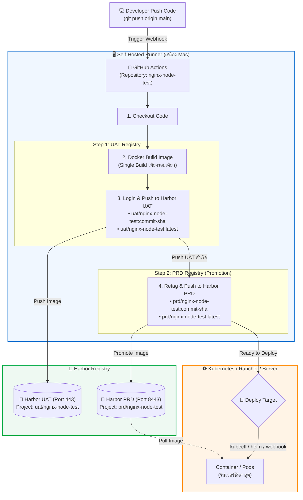

# 🚀 CI/CD Pipeline: GitHub Actions to Harbor (UAT & PRD)

โปรเจกต์ตัวอย่างการทำ CI/CD ด้วย **GitHub Actions (Self-Hosted Runner)** เพื่อ Build Docker Image และ Push ไปยัง **Harbor UAT** เมื่อผ่านการทดสอบจะทำการ Promote Image ต่อไปยัง **Harbor PRD** โดยอัตโนมัติ

---

## 🏗️ Architecture & Pipeline Flow



---

## 🔄 ลำดับขั้นตอนการทำงานแบบละเอียด (Step-by-Step Flow)

1. **Git Push:** Developer ทำการ commit และ push โค้ดขึ้น branch `main`
2. **Trigger Runner:** GitHub Actions ส่งคำสั่งมายัง Self-Hosted Runner ที่เปิดรับงานไว้บนเครื่อง (`./run.sh`)
3. **Checkout Source Code:** Runner ดึงโค้ดล่าสุดของ Commit นั้นมาเตรียมทำงาน
4. **Single Build Image:** 
   * คำสั่ง `docker build` จะสร้าง Image ขึ้นมาเพียง **รอบเดียว** ในเครื่อง
   * การ Build รอบเดียวทำให้การันตีได้ว่า Image ที่ผ่านการทดสอบบน UAT และที่นำไปรันบน PRD เป็นตัวเดียวกัน 100% (Bit-by-Bit Identical)
5. **Push to Harbor UAT (Port 443):**
   * ล็อกอินเข้า Harbor UAT (`10.5.3.56`)
   * ส่ง Image เข้าโปรเจกต์ `uat/nginx-node-test` พร้อม 2 Tags:
     * `<commit-sha>` (เช่น `e27d2cd...` สำหรับตรวจสอบย้อนกลับ)
     * `latest` (สำหรับเวอร์ชันล่าสุด)
6. **Promote to Harbor PRD (Port 8443):**
   * เมื่อสเต็ป UAT สำเร็จ จะนำ Image ตัวเดิมมาติด Tag ของ PRD (`docker tag`)
   * ล็อกอินเข้า Harbor PRD (`10.5.3.56:8443`)
   * ส่ง Image เข้าโปรเจกต์ `prd/nginx-node-test` พร้อม Tag `<commit-sha>` และ `latest`
7. **Ready to Deploy:** ระบบแจ้งเตือนความสำเร็จ พร้อมให้เซิร์ฟเวอร์ปลายทางหรือ Kubernetes (Rancher) ดึงไป Deploy ใช้งานจริง

---

## 📁 โครงสร้างโปรเจกต์ (Repository Structure)
```text
├── .github/
│   └── workflows/
│       └── ci.yml            # ไฟล์คำสั่ง CI/CD Pipeline
├── Dockerfile                # ไฟล์สำหรับสร้าง Docker Image
├── Readme.md                 # เอกสารอธิบายระบบและ Flow
└── ... (โค้ดของแอปพลิเคชัน)
```

---

## 🔐 1. การตั้งค่า GitHub Secrets

ก่อนเริ่มรัน ให้ไปที่ **Settings > Secrets and variables > Actions > New repository secret** ใน GitHub Repo:

| Secret Name | Value ตัวอย่าง | คำอธิบาย |
| :--- | :--- | :--- |
| `HARBOR_UAT_URL` | `10.5.3.56` | URL/IP ของ Harbor UAT |
| `HARBOR_UAT_USER` | `admin` หรือ `robot$cicd-unlimited` | Username สำหรับ UAT |
| `HARBOR_UAT_SECRET` | `Harbor12345` หรือ `Harbor12345!robot` | Password/Token สำหรับ UAT |
| `HARBOR_PRD_URL` | `10.5.3.56:8443` | URL/IP และ Port ของ Harbor PRD |
| `HARBOR_PRD_USER` | `admin` หรือ `robot$cicd-unlimited` | Username สำหรับ PRD |
| `HARBOR_PRD_SECRET` | `HarborPrd12345` หรือ `Harbor12345!robot` | Password/Token สำหรับ PRD |

---

## 🐳 2. ตัวอย่างไฟล์ Dockerfile

```dockerfile
FROM alpine:latest
RUN echo "App version: 1.0.0 built for Harbor UAT & PRD" > /app.txt
CMD ["cat", "/app.txt"]
```

---

## ⚙️ 3. ตัวอย่างไฟล์ `.github/workflows/ci.yml`

```yaml
name: Build and Push to Harbor (UAT & PRD)

on:
  push:
    branches: [ "main", "master" ]

jobs:
  build-and-promote:
    runs-on: self-hosted  # รันผ่าน Self-Hosted Runner บนเครื่อง Mac
    env:
      APP_NAME: nginx-node-test
      TAG: ${{ github.sha }}
      UAT_PROJECT: uat
      PRD_PROJECT: prd

    steps:
      - name: 1. Checkout Code
        uses: actions/checkout@v4

      # ==========================================
      # STEP 1: Login & Push ไปยัง Harbor UAT
      # ==========================================
      - name: 2. Login to Harbor UAT
        uses: docker/login-action@v3
        with:
          registry: ${{ secrets.HARBOR_UAT_URL }}
          username: ${{ secrets.HARBOR_UAT_USER }}
          password: ${{ secrets.HARBOR_UAT_SECRET }}

      - name: 3. Build and Push to UAT
        run: |
          UAT_IMG="${{ secrets.HARBOR_UAT_URL }}/${{ env.UAT_PROJECT }}/${{ env.APP_NAME }}:${{ env.TAG }}"
          UAT_LATEST="${{ secrets.HARBOR_UAT_URL }}/${{ env.UAT_PROJECT }}/${{ env.APP_NAME }}:latest"
          echo "🔨 กำลัง Build Docker Image..."
          docker build -t "$UAT_IMG" -t "$UAT_LATEST" .
          echo "📤 กำลัง Push Image ไปยัง Harbor UAT..."
          docker push "$UAT_IMG"
          docker push "$UAT_LATEST"
          echo "✅ Push เข้า Harbor UAT สำเร็จ!"

      # ==========================================
      # STEP 2: Retag & Push ไปยัง Harbor PRD
      # ==========================================
      - name: 4. Login to Harbor PRD
        uses: docker/login-action@v3
        with:
          registry: ${{ secrets.HARBOR_PRD_URL }}
          username: ${{ secrets.HARBOR_PRD_USER }}
          password: ${{ secrets.HARBOR_PRD_SECRET }}

      - name: 5. Retag and Push to PRD
        run: |
          UAT_IMG="${{ secrets.HARBOR_UAT_URL }}/${{ env.UAT_PROJECT }}/${{ env.APP_NAME }}:${{ env.TAG }}"
          PRD_IMG="${{ secrets.HARBOR_PRD_URL }}/${{ env.PRD_PROJECT }}/${{ env.APP_NAME }}:${{ env.TAG }}"
          PRD_LATEST="${{ secrets.HARBOR_PRD_URL }}/${{ env.PRD_PROJECT }}/${{ env.APP_NAME }}:latest"
          echo "📦 กำลังโปรโมต Image จาก UAT ไป PRD..."
          docker tag "$UAT_IMG" "$PRD_IMG"
          docker tag "$UAT_IMG" "$PRD_LATEST"
          docker push "$PRD_IMG"
          docker push "$PRD_LATEST"
          echo "✅ Push เข้า Harbor PRD สำเร็จ!"

      # ==========================================
      # STEP 3: Deploy (ดึง Image จาก Harbor PRD มารัน)
      # ==========================================
      - name: 6. Deploy Application (Pull from Harbor PRD)
        run: |
          DEPLOY_IMG="${{ secrets.HARBOR_PRD_URL }}/${{ env.PRD_PROJECT }}/${{ env.APP_NAME }}:${{ env.TAG }}"
          echo "📥 กำลังดึง Image จาก Harbor PRD: $DEPLOY_IMG ..."
          docker pull "$DEPLOY_IMG"

          echo "🚀 กำลัง Deploy คอนเทนเนอร์ด้วย Docker..."
          docker rm -f nginx-node-test-app 2>/dev/null || true
          docker run -d \
            --name nginx-node-test-app \
            -p 3001:3000 \
            --restart always \
            "$DEPLOY_IMG"

          echo "⏳ รอให้คอนเทนเนอร์เริ่มต้นทำงาน (3 วินาที)..."
          sleep 3

          echo "🔍 ตรวจสอบสถานะแอปพลิเคชัน (Health Check)..."
          if curl -s -I http://localhost:3001 | grep -q "200 OK"; then
            echo "✅ Deploy สำเร็จสมบูรณ์! แอปพลิเคชันพร้อมใช้งานที่ http://localhost:3001"
          else
            echo "⚠️ ตรวจสอบแอปพลิเคชัน..."
            docker ps -f name=nginx-node-test-app
            docker logs --tail 20 nginx-node-test-app
          fi

      # ==========================================
      # STEP 4: แจ้งเตือนเมื่อทุกขั้นตอนสำเร็จ
      # ==========================================
      - name: 7. Notify Success
        if: success()
        run: |
          echo "🎉 CI/CD สำเร็จครบทุกขั้นตอน (UAT, PRD และ Deploy)!"
          echo "🚀 Image Tag '${{ env.TAG }}' กำลังทำงานอยู่ที่ http://localhost:3001"
```

---

## 🚢 4. วิธี Deploy แอปพลิเคชัน (ดึง Image จาก Harbor)

### 🅰️ แบบที่ 1: Deploy ด้วย Docker Run / Docker Compose (บน VM / Server)

#### คำสั่งดึงและรันด้วย Docker Run:
```bash
# ล็อกอินเข้า Harbor PRD
echo "HarborPrd12345" | docker login 10.5.3.56:8443 -u admin --password-stdin

# ดึง Image ล่าสุดจาก Harbor PRD
docker pull 10.5.3.56:8443/prd/nginx-node-test:latest

# รันคอนเทนเนอร์
docker run -d \
  --name nginx-node-test-app \
  -p 3001:3000 \
  --restart always \
  10.5.3.56:8443/prd/nginx-node-test:latest
```

#### หรือสั่งรันด้วย Docker Compose:
```bash
docker compose pull
docker compose up -d
```

---

### 🅱️ แบบที่ 2: Deploy ลง Kubernetes / Rancher

โปรเจกต์มีไฟล์ Manifest เตรียมไว้ในโฟลเดอร์ `k8s/`:
* `k8s/deployment.yaml`
* `k8s/service.yaml`

#### 1. สร้าง Secret สำหรับดึง Image จาก Harbor (Private Project):
```bash
kubectl create secret docker-registry harbor-registry-secret \
  --docker-server=10.5.3.56:8443 \
  --docker-username=admin \
  --docker-password=HarborPrd12345 \
  --namespace=default
```

#### 2. สั่ง Deploy ลง Cluster:
```bash
kubectl apply -f k8s/
```

#### 3. วิธีอัปเดต Image เวอร์ชันใหม่ผ่าน CI หรือ CLI:
```bash
kubectl set image deployment/nginx-node-test nginx-node-test=10.5.3.56:8443/prd/nginx-node-test:<NEW_TAG> -n default
kubectl rollout status deployment/nginx-node-test -n default
```

---

## 🛠️ 5. ข้อมูลและลิงก์สำหรับผู้ดูแลระบบ

* **Harbor UAT Web UI:** [https://localhost](https://localhost) (Port 443)
* **Harbor PRD Web UI:** [https://localhost:8443](https://localhost:8443) (Port 8443)
* **คำสั่งเปิด Runner รับงาน (Terminal เครื่อง Mac):**
  ```bash
  cd ~/Desktop/actions-runner && ./run.sh
  ```
