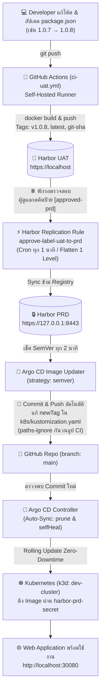

# 🚀 คู่มือติดตั้งและ Flow การทำงาน: GitHub Actions + Harbor Approval + Argo CD GitOps

เอกสารนี้สรุป **สถาปัตยกรรม, Flow การทำงานทั้งหมด (End-to-End)** และ **ขั้นตอนการติดตั้งตั้งค่าทั้งหมด** สำหรับระบบ CI/CD แบบ GitOps แท้ โดยใช้ **Harbor UAT เป็นด่าน Approve (`[approved-prd]`)** และใช้ **Argo CD + Argo CD Image Updater (`write-back-method: git`)** ทำ Auto-Deploy ลง Kubernetes (`k3d: dev-cluster`)

---

## 🏗️ 1. ภาพรวม Flow การทำงานทั้งหมด (End-to-End)



### สรุปการทำงาน 3 ช่วงหลัก

```text
┌──────────────────────────────────────────────────────────────────────┐
│ 1. ฝั่งพัฒนาและ CI (GitHub & Self-Hosted Runner)                     │
└──────────────────────────────────────────────────────────────────────┘
  💻 Developer แก้โค้ด / อัปเดตเลข version ใน package.json (เช่น 1.0.8)
     │
     ▼ (git push ขึ้น GitHub)
  🤖 GitHub Actions (.github/workflows/ci-uat.yml)
     │ • อ่านเลขเวอร์ชันจาก package.json (ตัด v ซ้ำอัตโนมัติ)
     │ • Build Docker Image (ติด Tag: v1.0.8, latest, git-sha)
     ▼ (docker push เข้าโปรเจกต์ uat)

┌──────────────────────────────────────────────────────────────────────┐
│ 2. พักรอตรวจสอบและกด Approve (Harbor UAT - https://localhost)        │
└──────────────────────────────────────────────────────────────────────┘
  🐳 Harbor UAT (uat/nginx-node-test:v1.0.8)
     │ ⏸️ Image หยุดรออยู่ที่ UAT (ยังไม่ข้ามไป PRD เพราะยังไม่มีป้าย)
     │
     ▼ 👤 ผู้ดูแลตรวจเช็คผ่าน → กด ADD LABELS เลือกป้ายสีเขียว [approved-prd]
  ⚡ Replication Rule (approve-label-uat-to-prd)
     │ • ตรวจสอบทุกๆ 1 นาที (Cron: 0 */1 * * * *)
     │ • คัดกรองเฉพาะ Image ใน uat/** ที่มีป้าย [approved-prd]
     │ • แปลงโปรเจกต์ uat/* → prd/* (Flatten 1 Level)
     ▼ (Sync ข้าม Registry อัตโนมัติ)

┌──────────────────────────────────────────────────────────────────────┐
│ 3. GitOps Auto-Deploy (Harbor PRD → Image Updater → Git → Argo CD)   │
└──────────────────────────────────────────────────────────────────────┘
  🔒 Harbor PRD (https://127.0.0.1:8443 → prd/nginx-node-test:v1.0.8)
     │
     ▼ 🔄 Argo CD Image Updater เช็ค Harbor PRD อัตโนมัติ
  📝 Git Write-Back (write-back-method: git)
     │ • ตรวจพบ Tag ใหม่ (v1.0.8 > v1.0.7) ตาม strategy: semver
     │ • Commit & Push แก้ไข newTag ใน k8s/kustomization.yaml บน main
     │ • CI ไม่รันซ้ำเพราะมี paths-ignore: ['k8s/**', 'argocd/**']
     ▼
  🐙 Argo CD (http://localhost:30900)
     │ • ตรวจพบ Commit ใหม่บน main → สั่ง Auto-Sync (prune + selfHeal)
     ▼
  ☸️ Kubernetes Cluster (k3d: dev-cluster)
     │ • ดึง Image v1.0.8 จาก Harbor PRD ผ่าน harbor-prd-secret
     │ • ทำ Rolling Update สลับ Pod 2 Replicas แบบ Zero-Downtime
     ▼
  🌐 Web Application พร้อมใช้งานทันทีที่ http://localhost:30080
```

---

## 📁 2. โครงสร้างไฟล์ที่เกี่ยวข้องในโปรเจกต์

| ไฟล์ | หน้าที่ |
| :--- | :--- |
| `.github/workflows/ci-uat.yml` | Build & Push Image เข้า Harbor UAT อย่างเดียว และมี `paths-ignore: ['k8s/**', 'argocd/**']` ป้องกันการวนลูป CI |
| `.github/workflows/cd-prd.yml` | ปิด Auto-Trigger แล้ว (เหลือเฉพาะ `workflow_dispatch` เผื่อกดรันมือ) |
| `k8s/deployment.yaml` | Deployment ของแอป (2 Replicas, ใช้ `harbor-prd-secret`, พอร์ต 3000) |
| `k8s/service.yaml` | Service แบบ NodePort เปิดพอร์ต `30080` |
| `k8s/kustomization.yaml` | ไฟล์จัดการ Image Tag (`newTag`) ที่ Argo CD Image Updater จะเข้ามาแก้และ Commit กลับลง Git |
| `argocd/application.yaml` | ไฟล์ Argo CD Application พร้อม Annotations ของ Image Updater (แยกอยู่นอกโฟลเดอร์ `k8s/` เพื่อไม่ให้ Sync ซ้อนกัน) |

---

## 🛠️ 3. วิธีติดตั้งและตั้งค่าทั้งหมด (Step-by-Step)

### ขั้นตอนที่ 1: เปิดระบบพื้นฐาน (Docker, K3d, Harbor UAT/PRD, Runner)
รันสคริปต์เปิดระบบบนเครื่อง Mac:
```bash
bash ~/Desktop/Harbor-Config/Start-Harbor.command
```
ตรวจสอบว่า K3d Cluster พร้อมทำงาน:
```bash
kubectl get nodes
# แสดง: k3d-dev-cluster-server-0   Ready   control-plane
```

---

### ขั้นตอนที่ 2: ตั้งค่า Harbor UAT ➔ PRD Replication (ด่าน Approve)
ทำบนหน้าเว็บ **Harbor UAT** (`https://localhost`):
1. **เพิ่ม Endpoint ของ Harbor PRD:**
   - ไปที่ **Administration** ➔ **Registries** ➔ **+ NEW ENDPOINT**
   - Provider: `Harbor` | Name: `harbor-prd-endpoint`
   - Endpoint URL: `https://10.5.3.56:8443`
   - Access ID: `admin` | Access Secret: `HarborPrd12345`
   - **Verify Remote Cert:** เอาเครื่องหมายถูกออก (Uncheck) ➔ กด **TEST CONNECTION** ➔ **OK**
2. **สร้าง Label สีเขียว `[approved-prd]`:**
   - ไปที่ **Projects** ➔ `uat` ➔ **Labels** ➔ สร้าง Label ชื่อ `approved-prd`
3. **สร้าง Replication Rule (`approve-label-uat-to-prd`):**
   - ไปที่ **Administration** ➔ **Replications** ➔ **+ NEW REPLICATION RULE**
   - Replication mode: `Push-based`
   - Source resource filter: Name `uat/**`, Label `approved-prd`
   - Destination registry: `harbor-prd-endpoint` | Namespace: `prd` (Flatten 1 Level)
   - Trigger Mode: `Scheduled` (`0 */1 * * * *` ทุก 1 นาที)
   - ติ๊ก **Override** และ **Enabled** ➔ **SAVE**

---

### ขั้นตอนที่ 3: ติดตั้ง Argo CD และเปิด Web UI บนพอร์ต `30900`
```bash
# 1. สร้าง namespace และติดตั้ง Argo CD (ใช้ --server-side เพื่อรองรับ CRD ขนาดใหญ่)
kubectl create namespace argocd
kubectl apply --server-side --force-conflicts -n argocd \
  -f https://raw.githubusercontent.com/argoproj/argo-cd/stable/manifests/install.yaml

# 2. เปิดโหมด HTTP (insecure) เพื่อให้เข้าผ่าน NodePort Proxy ได้ทันที
kubectl patch configmap argocd-cmd-params-cm -n argocd \
  --type merge -p '{"data":{"server.insecure":"true"}}'

# 3. เปลี่ยน Service argocd-server เป็น NodePort 30900
kubectl patch svc argocd-server -n argocd --type='json' \
  -p='[{"op":"replace","path":"/spec/type","value":"NodePort"},{"op":"replace","path":"/spec/ports/0/nodePort","value":30900}]'

# 4. รีสตาร์ท argocd-server ให้ค่า insecure มีผล
kubectl rollout restart deployment/argocd-server -n argocd

# 5. ดึงรหัสผ่าน admin สำหรับล็อกอินเข้า http://localhost:30900
kubectl -n argocd get secret argocd-initial-admin-secret \
  -o jsonpath="{.data.password}" | base64 -d; echo
```

---

### ขั้นตอนที่ 4: ติดตั้ง Argo CD Image Updater (`v0.16.0`) และเชื่อมกับ Harbor PRD
```bash
# 1. ติดตั้ง Argo CD Image Updater v0.16.0 (รองรับ Application Annotations)
kubectl apply --server-side --force-conflicts -n argocd \
  -f https://raw.githubusercontent.com/argoproj-labs/argocd-image-updater/v0.16.0/manifests/install.yaml

# 2. สร้าง Secret สำหรับให้ Image Updater ล็อกอินเช็ค Tag บน Harbor PRD
kubectl create secret generic harbor-prd-cred \
  --from-literal=creds='robot$cicd-unlimited:ybXtqTtJmcNjMnVFIPJvFmuCnAmGhP7s' \
  -n argocd

# 3. ตั้งค่า Registry Config (อนุญาต Self-Signed SSL สำหรับ Harbor ภายใน)
cat <<'EOF' | kubectl apply -f -
apiVersion: v1
kind: ConfigMap
metadata:
  name: argocd-image-updater-config
  namespace: argocd
data:
  registries.conf: |
    registries:
      - name: Harbor PRD
        api_url: https://10.5.3.56:8443
        prefix: 10.5.3.56:8443
        credentials: secret:argocd/harbor-prd-cred#creds
        insecure: true
EOF

# 4. รีสตาร์ท Image Updater เพื่อให้โหลด Config ใหม่
kubectl rollout restart deployment/argocd-image-updater -n argocd
```

---

### ขั้นตอนที่ 5: สร้าง Secret สำหรับ Write-Back กลับเข้า GitHub และลงทะเบียน Application
```bash
# 1. สร้าง ImagePullSecret ใน namespace default (สำหรับดึง Image จาก Harbor PRD)
kubectl create secret docker-registry harbor-prd-secret \
  --docker-server=10.5.3.56:8443 \
  --docker-username='robot$cicd-unlimited' \
  --docker-password='ybXtqTtJmcNjMnVFIPJvFmuCnAmGhP7s' \
  --namespace=default

# 2. สร้าง Secret GitHub Token (PAT ที่มีสิทธิ์ repo) ใน namespace argocd
kubectl create secret generic git-creds \
  --from-literal=username=latthapholss \
  --from-literal=password=<GITHUB_PAT> \
  -n argocd

# 3. ลงทะเบียน Argo CD Application จากไฟล์ในโปรเจกต์
kubectl apply -f argocd/application.yaml
```

*(หมายเหตุ: หากก่อนหน้านี้เคยติดตั้ง Keel ไว้ ให้ถอดออกด้วยคำสั่ง `kubectl delete namespace keel` เพื่อไม่ให้ชนกับ Argo CD)*

---

## 🌐 4. สรุปลิงก์และข้อมูลเข้าใช้งาน (Quick Reference)

| ระบบ | URL | Username / Password |
| :--- | :--- | :--- |
| **Harbor UAT** | https://localhost | `admin` / `Harbor12345` |
| **Harbor PRD** | https://127.0.0.1:8443 | `admin` / `HarborPrd12345` |
| **Argo CD Web UI** | http://localhost:30900 | `admin` / ดูด้วยคำสั่ง `kubectl -n argocd get secret argocd-initial-admin-secret -o jsonpath="{.data.password}" \| base64 -d; echo` |
| **Web Application** | http://localhost:30080 | หน้าเว็บแอป (`/` และ `/api/version`) |

---

## 🔍 5. คำสั่งตรวจสอบและทดสอบการทำงาน (Verification)

### ตรวจสอบสถานะระบบทั้งหมด
```bash
# ดูสถานะ Pods และ Application ใน Argo CD (ต้องเป็น Synced / Healthy)
kubectl get pods,applications -n argocd

# ดู Log การเช็ค Harbor PRD และการ Write-Back กลับ Git ของ Image Updater
kubectl logs -f deployment/argocd-image-updater -n argocd

# ดูสถานะ Pods ของแอปพลิเคชันจริง
kubectl get pods -n default -o wide

# ทดสอบเรียกดูเวอร์ชันที่กำลังรันอยู่จริง
curl -s http://localhost:30080/api/version
```

### วิธีทดสอบ Loop ตั้งแต่ต้นจนจบ
1. แก้เลข `"version"` ใน `package.json` (เช่น `1.0.7` ➔ `1.0.8`) แล้ว `git commit` + `git push`
2. ตรวจสอบ **GitHub Actions** ➔ Build & Push Tag `v1.0.8` เข้า **Harbor UAT**
3. เข้า **Harbor UAT** (`https://localhost`) ➔ กด **`ADD LABELS`** เลือก **`[approved-prd]`** ให้กับ `v1.0.8`
4. รอไม่เกิน 1 นาที ➔ `v1.0.8` จะถูก Replication ไปยัง **Harbor PRD** (`https://127.0.0.1:8443`)
5. รอไม่เกิน 2 นาที ➔ **Argo CD Image Updater** จะตรวจเจอ `v1.0.8` และ Commit แก้ `k8s/kustomization.yaml` บน GitHub (`main`) อัตโนมัติ
6. **Argo CD** (`http://localhost:30900`) จะสั่ง Auto-Sync ➔ เปิด `http://localhost:30080` จะเห็นหน้าเว็บอัปเดตเป็น **`v1.0.8`** ทันที!
