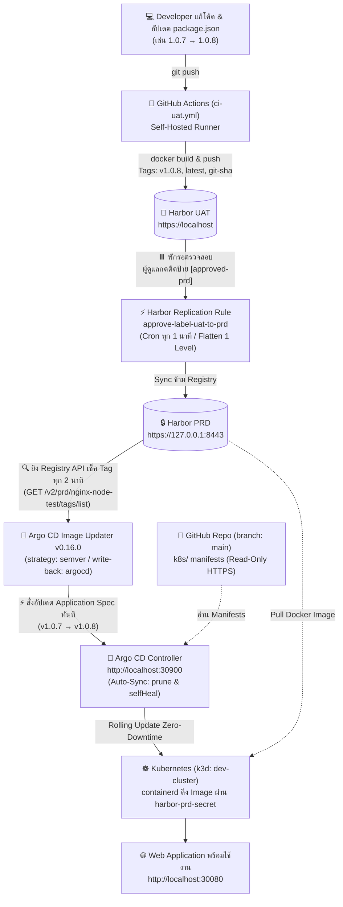

# 🚀 คู่มือฉบับสมบูรณ์: GitHub Actions + Harbor Approval + Argo CD + Argo CD Image Updater

เอกสารนี้สรุป **สถาปัตยกรรม, กลไกการทำงานเชิงลึก, ทางเลือกการเชื่อมต่อ Git และขั้นตอนการติดตั้งทั้งหมด** สำหรับระบบ CI/CD + Auto-Deploy บน Kubernetes (`k3d: dev-cluster` และรองรับการนำไปใช้บน **Rancher**) ที่ผ่านการทดสอบจริงครบ Loop 100% (`v1.0.7` ➔ `v1.0.8`, `errors=0`)

---

## 🏗️ 1. ภาพรวมสถาปัตยกรรมและ Loop การทำงานทั้งหมด (End-to-End)



### สรุปลำดับการทำงาน 3 ช่วงหลัก

```text
┌──────────────────────────────────────────────────────────────────────┐
│ 1. ฝั่งพัฒนาและ CI (GitHub & Self-Hosted Runner)                     │
└──────────────────────────────────────────────────────────────────────┘
  💻 Developer แก้โค้ด / อัปเดตเลข version ใน package.json (เช่น 1.0.8)
     │
     ▼ (git push ขึ้น GitHub)
  🤖 GitHub Actions (.github/workflows/ci-uat.yml)
     │ • อ่านเลขเวอร์ชันจาก package.json (ตัดตัว v ซ้ำอัตโนมัติ)
     │ • Build Docker Image (ติด Tag: v1.0.8, latest, git-sha)
     ▼ (docker push เข้าโปรเจกต์ uat)

┌──────────────────────────────────────────────────────────────────────┐
│ 2. พักรอตรวจสอบและกด Approve (Harbor UAT - https://localhost)        │
└──────────────────────────────────────────────────────────────────────┘
  🐳 Harbor UAT (uat/nginx-node-test:v1.0.8)
     │ ⏸️ Image หยุดรออยู่ที่ UAT (ยังไม่ข้ามไป PRD เพราะยังไม่มีป้าย)
     │
     ▼ 👤 ผู้ดูแลตรวจเช็คผ่าน → กด ADD LABELS เลือกป้ายสีเขียว [approved-prd]
  ⚡ Replication Rule (approve-label-uat-to-prd)
     │ • ตรวจสอบทุกๆ 1 นาที (Cron: 0 */1 * * * *)
     │ • คัดกรองเฉพาะ Image ใน uat/** ที่มีป้าย [approved-prd]
     │ • แปลงโปรเจกต์ uat/* → prd/* (Flatten 1 Level)
     ▼ (Sync ข้าม Registry อัตโนมัติ)

┌──────────────────────────────────────────────────────────────────────┐
│ 3. คลัง Production & Auto-Deploy (Harbor PRD → Argo CD → K8s)        │
└──────────────────────────────────────────────────────────────────────┘
  🔒 Harbor PRD (https://127.0.0.1:8443 → prd/nginx-node-test:v1.0.8)
     │
     ▼ 🔄 Argo CD Image Updater เช็ค Tag บน Harbor PRD ทุก 2 นาที (แทน Keel)
  👁️ Argo CD Image Updater (namespace: argocd)
     │ • ดึงรายชื่อ Tag → กรองเฉพาะ vX.Y.Z → เรียง SemVer พบ v1.0.8 > v1.0.7
     │ • สั่งอัปเดต Image Tag ตรงเข้า Argo CD Application (write-back: argocd)
     ▼
  🐙 Argo CD (http://localhost:30900)
     │ • สั่ง Auto-Sync (prune + selfHeal) ไปยัง Kubernetes Cluster
     ▼
  ☸️ Kubernetes Cluster (k3d: dev-cluster)
     │ • containerd ดึง Image v1.0.8 จาก Harbor PRD ผ่าน harbor-prd-secret
     │ • ทำ Rolling Update สลับ Pod ใหม่ 2 Replicas แบบ Zero-Downtime
     ▼
  🌐 Web Application พร้อมใช้งานทันทีที่ http://localhost:30080
```

> [!IMPORTANT]
> **ทำไมไม่ให้ GitHub Actions แก้ `k8s/deployment.yaml` ทันทีตอน push?**
> เพราะในระบบนี้มี **ด่านพักรอ Approve ที่ Harbor UAT (ป้าย `[approved-prd]`)** หาก GitHub Actions แก้ Tag ใน Git ทันทีตอน push ตัว Argo CD จะพยายามดึง `v1.0.8` จาก Harbor PRD ก่อนที่ผู้ดูแลจะกด Approve ทำให้ Pod ติด `ImagePullBackOff` การใช้ **Argo CD Image Updater** เฝ้า Harbor PRD จึงช่วยรักษาด่าน Approve ไว้ได้ 100%

---

## 🧠 2. เจาะลึกกลไกการทำงานของ Argo CD Image Updater

### 2.1 ตัว Image โหลดมาจากไหน? (แยก 2 ส่วนให้ชัดเจน)
1. **Image ของโปรแกรม Argo CD Image Updater เอง (ตอนติดตั้ง):**
   - โหลดจาก Official Registry บน **Quay.io**: `quay.io/argoprojlabs/argocd-image-updater:v0.16.0`
   - ผ่าน Manifest ทางการ: `https://raw.githubusercontent.com/argoproj-labs/argocd-image-updater/v0.16.0/manifests/install.yaml`
2. **Image ของแอปพลิเคชัน (`nginx-node-test`):**
   - **Argo CD Image Updater ไม่ได้ Pull (โหลด) ตัว Image แอปลงมาเอง** — มันแค่ยิง Registry API ไปอ่านรายชื่อ Tag จาก **Harbor PRD (`https://10.5.3.56:8443/prd/nginx-node-test`)** โดยใช้สิทธิ์จาก Secret `harbor-prd-cred` และค่าใน ConfigMap `argocd-image-updater-config`
   - **คนที่โหลด (Pull) ตัว Docker Image จริงๆ** คือ **Kubernetes (`containerd` บนโหนด `k3d-dev-cluster-server-0`)** ที่ดึง Image จาก Harbor PRD ผ่าน `harbor-prd-secret` ใน namespace `default`

### 2.2 รู้ได้อย่างไรว่า Tag ไหนคือ "ตัวล่าสุด" ที่เพิ่งขึ้นมา?
ทุกรอบการทำงาน (ค่าเริ่มต้นทุก **2 นาที**) Argo CD Image Updater จะทำงานตามลำดับ 3 ขั้นตอน:

1. **ดึงรายชื่อ Tag ทั้งหมดจาก Harbor PRD:**
   ยิง HTTP Request ไปที่ Docker Registry v2 API:
   ```text
   GET https://10.5.3.56:8443/v2/prd/nginx-node-test/tags/list
   ```
   ได้รายการกลับมาทั้งหมด เช่น `["latest", "v1.0.1", "v1.0.4", "v1.0.7", "v1.0.8", "4a7c98b3026..."]`

2. **คัดกรองเฉพาะ Tag ที่ตรงตามกติกา (`allow-tags`):**
   ตาม Annotation ใน `argocd/application.yaml`:
   ```yaml
   argocd-image-updater.argoproj.io/app.allow-tags: regexp:^v[0-9]+\.[0-9]+\.[0-9]+$
   ```
   ➔ ตัด `latest` และ `4a7c98b...` ทิ้ง เหลือเฉพาะ `["v1.0.1", "v1.0.4", "v1.0.7", "v1.0.8"]`

3. **เรียงลำดับหาตัวใหม่สุดตามกลยุทธ์ (`update-strategy: semver`):**
   - เรียงตามมาตรฐาน **Semantic Versioning (`Major.Minor.Patch`)** ไม่ได้ดูจากเวลาอัปโหลด
   - เปรียบเทียบกับเวอร์ชันที่กำลังรันอยู่ใน Argo CD (`v1.0.7`) แล้วพบว่า **`v1.0.8` > `v1.0.7`** ➔ จึงสั่งอัปเดตทันที!
   - *(ข้อควรรู้: หากเผลอ push เวอร์ชันที่ต่ำกว่า เช่น `v1.0.6` ทีหลัง ระบบจะ **ไม่** ถอยเวอร์ชันให้ เพราะ `v1.0.8` ยังสูงกว่า)*

### 2.3 เปรียบเทียบ Strategy ทั้ง 4 แบบ (เทียบกับ Keel)

| Update Strategy | วิธีตัดสินว่าตัวไหนล่าสุด | เทียบเท่า Keel | เหมาะกับ Tag แบบไหน |
| :--- | :--- | :--- | :--- |
| **`semver`** *(ที่ใช้อยู่)* | เทียบเลขเวอร์ชัน (`v1.0.8 > v1.0.7`) | `keel.sh/policy: all` | `v1.0.7`, `1.2.0` |
| **`newest-build`** | เช็ค `created` timestamp ใน Image Manifest ใครสร้างล่าสุดเอาตัวนั้น | — | `commit-sha`, `build-123` |
| **`digest`** | เฝ้า Tag เดิมตัวเดียวแล้วเช็ค `sha256` Hash เปลี่ยนเมื่อไหร่อัปเดตทันที | `keel.sh/policy: force` | `:latest` |
| **`alphabetical`** | เรียงตามตัวอักษร/วันที่ (`20261120 > 20261119`) | — | `20261120-01` |

---

## 🔀 3. เปรียบเทียบวิธี Write-Back และการยืนยันตัวตนกับ Git (รองรับทั้ง K3d และ Rancher)

| วิธี | แก้ไฟล์ใน Git ไหม? | Cluster ต้องถือสิทธิ์เขียน Git ไหม? | วันหมดอายุ | ข้อดี / เหมาะกับใคร |
| :--- | :---: | :---: | :---: | :--- |
| **`write-back-method: argocd`** *(ที่ใช้อยู่ปัจจุบัน)* | ไม่แก้ | **ไม่ต้องถือ** (อ่าน HTTPS Read-Only) | ไม่มี | **ง่ายที่สุด** ไม่ต้องสร้าง PAT/SSH Key, ทำงานเหมือน Keel แต่มี Argo CD UI + Rollback |
| **`write-back-method: git` + SSH Deploy Key** | แก้ `k8s/kustomization.yaml` | ถือเฉพาะ Repo เดียว | ไม่มี | **GitOps แท้**, ปลอดภัย, ไม่ผูกบัญชีส่วนตัว, ใช้บน **Rancher** ได้ง่าย |
| **`write-back-method: git` + GitHub PAT** | แก้ `k8s/kustomization.yaml` | ถือ (ตามสิทธิ์ Token) | มี (ต้องต่ออายุ) | ตั้งค่าง่ายผ่าน HTTPS |
| **`write-back-method: git` + GitHub App** | แก้ `k8s/kustomization.yaml` | ถือ (หมุน Token อัตโนมัติ) | อัตโนมัติ | มาตรฐานระดับ Enterprise |
| **Harbor PRD Webhook ➔ GitHub Actions** | แก้ YAML ใน Git | **ไม่ต้องถือ** | ไม่มี | ไม่ต้องลง Image Updater ใช้แค่ Argo CD + `GITHUB_TOKEN` |

### หมายเหตุกรณีใช้งาน SSH Deploy Key บน **Rancher** (หากอนาคตต้องการเปิด `write-back-method: git`)
1. สร้าง SSH Key บนเครื่องไหนก็ได้: `ssh-keygen -t ed25519 -C "argocd-rancher-prd" -N "" -f argocd-rancher-key`
2. นำ Public Key (`.pub`) ไปวางใน GitHub Repo ➔ **Settings ➔ Deploy keys ➔ Add deploy key** (ติ๊ก **Allow write access**)
3. นำ Private Key ไปสร้างเป็น Opaque Secret ชื่อ `git-creds` (key: `sshPrivateKey`) ใน namespace `argocd` ผ่านหน้าเว็บ **Rancher ➔ Storage ➔ Secrets** และผูก Repo ใน **Argo CD UI ➔ Settings ➔ Repositories ➔ VIA SSH**
4. **กรณี Firewall องค์กรบล็อก Port 22 (SSH):** ให้เพิ่มใน `argocd-image-updater-ssh-config` เพื่อให้วิ่ง SSH ผ่าน **Port 443** ของ GitHub แทน:
   ```text
   Host github.com
     HostName ssh.github.com
     Port 443
     User git
   ```

---

## 📁 4. โครงสร้างไฟล์ที่เกี่ยวข้องในโปรเจกต์

| ไฟล์ | หน้าที่ |
| :--- | :--- |
| `.github/workflows/ci-uat.yml` | Build & Push Image เข้า Harbor UAT เท่านั้น มี `paths-ignore: ['k8s/**', 'argocd/**']` ป้องกันวนลูป CI |
| `.github/workflows/cd-prd.yml` | ปิด Auto-Trigger แล้ว (เหลือเฉพาะ `workflow_dispatch` เผื่อกดรันด้วยมือ) |
| `k8s/deployment.yaml` | Deployment ของแอป (2 Replicas, ใช้ `harbor-prd-secret`, พอร์ต 3000) |
| `k8s/service.yaml` | Service แบบ NodePort เปิดพอร์ต `30080` |
| `k8s/kustomization.yaml` | ไฟล์ Kustomize รวม `deployment.yaml` + `service.yaml` และระบุ `images.newTag` |
| `argocd/application.yaml` | ไฟล์ Argo CD Application พร้อม Annotations ของ Image Updater (แยกอยู่นอกโฟลเดอร์ `k8s/` เพื่อไม่ให้ Sync ตัวเองซ้อนกัน) |

---

## 🛠️ 5. ขั้นตอนการติดตั้งและตั้งค่าทั้งหมดตั้งแต่ต้น (Step-by-Step)

### ขั้นตอนที่ 1: เปิดระบบพื้นฐาน (Docker, K3d, Harbor UAT/PRD, Runner)
```bash
bash ~/Desktop/Harbor-Config/Start-Harbor.command
kubectl get nodes
# แสดง: k3d-dev-cluster-server-0   Ready   control-plane
```

### ขั้นตอนที่ 2: ตั้งค่า Harbor UAT ➔ PRD Replication (ด่าน Approve)
ทำบนหน้าเว็บ **Harbor UAT** (`https://localhost`):
1. **Administration ➔ Registries ➔ + NEW ENDPOINT:**
   - Provider: `Harbor` | Name: `harbor-prd-endpoint` | URL: `https://10.5.3.56:8443`
   - Access ID: `admin` | Access Secret: `HarborPrd12345` | **Uncheck Verify Remote Cert** ➔ **TEST CONNECTION** ➔ **OK**
2. **Projects ➔ `uat` ➔ Labels:** สร้าง Label สีเขียวชื่อ `approved-prd`
3. **Administration ➔ Replications ➔ + NEW REPLICATION RULE:**
   - Name: `approve-label-uat-to-prd` | Mode: `Push-based`
   - Source filter: Name `uat/**`, Label `approved-prd`
   - Destination: `harbor-prd-endpoint` | Namespace: `prd` (Flatten 1 Level)
   - Trigger Mode: `Scheduled` (`0 */1 * * * *` ทุก 1 นาที) | ติ๊ก **Override** & **Enabled** ➔ **SAVE**

### ขั้นตอนที่ 3: ติดตั้ง Argo CD และเปิด Web UI บนพอร์ต `30900`
```bash
# 1. สร้าง namespace และติดตั้ง Argo CD (ใช้ --server-side รองรับ CRD ขนาดใหญ่)
kubectl create namespace argocd
kubectl apply --server-side --force-conflicts -n argocd \
  -f https://raw.githubusercontent.com/argoproj/argo-cd/stable/manifests/install.yaml

# 2. เปิดโหมด HTTP (insecure) เพื่อให้เข้าผ่าน NodePort Proxy (:30900) ได้ทันที
kubectl patch configmap argocd-cmd-params-cm -n argocd \
  --type merge -p '{"data":{"server.insecure":"true"}}'

# 3. เปลี่ยน Service argocd-server เป็น NodePort 30900 (แทนพอร์ต Keel เดิม)
kubectl delete namespace keel --ignore-not-found
kubectl patch svc argocd-server -n argocd --type='json' \
  -p='[{"op":"replace","path":"/spec/type","value":"NodePort"},{"op":"replace","path":"/spec/ports/0/nodePort","value":30900}]'

# 4. รีสตาร์ท argocd-server และดึงรหัสผ่าน admin
kubectl rollout restart deployment/argocd-server -n argocd
kubectl -n argocd get secret argocd-initial-admin-secret \
  -o jsonpath="{.data.password}" | base64 -d; echo
```

### ขั้นตอนที่ 4: ติดตั้ง Argo CD Image Updater (`v0.16.0`) และเชื่อมกับ Harbor PRD
```bash
# 1. ติดตั้ง Argo CD Image Updater v0.16.0 (รองรับ Application Annotations)
kubectl apply --server-side --force-conflicts -n argocd \
  -f https://raw.githubusercontent.com/argoproj-labs/argocd-image-updater/v0.16.0/manifests/install.yaml

# 2. สร้าง Secret สำหรับให้ Image Updater ล็อกอินอ่าน Tag จาก Harbor PRD
kubectl create secret generic harbor-prd-cred \
  --from-literal=creds='robot$cicd-unlimited:ybXtqTtJmcNjMnVFIPJvFmuCnAmGhP7s' \
  -n argocd

# 3. ตั้งค่า Registry Config (ปิดตรวจ SSL สำหรับ Self-Signed Cert ภายใน)
cat <<'EOF' | kubectl apply -f -
apiVersion: v1
kind: ConfigMap
metadata:
  name: argocd-image-updater-config
  namespace: argocd
data:
  registries.conf: |
    registries:
      - name: Harbor PRD
        api_url: https://10.5.3.56:8443
        prefix: 10.5.3.56:8443
        credentials: secret:argocd/harbor-prd-cred#creds
        insecure: true
EOF

# 4. รีสตาร์ท Image Updater เพื่อให้โหลด Config ใหม่
kubectl rollout restart deployment/argocd-image-updater -n argocd
```

#### 💡 ท่าเสริม: ใช้ `docker-registry` Secret (`pullsecret:`) แทนการสร้าง `harbor-prd-cred` แยก
หากมี ImagePullSecret (`kubernetes.io/dockerconfigjson`) เช่น `harbor-prd-secret` อยู่แล้ว สามารถชี้ Argo CD Image Updater ไปใช้ Secret ตัวนั้นโดยตรงด้วย prefix **`pullsecret:`** ได้ 2 แบบ:

1. **แบบปลอดภัยสุด (ไว้ใน namespace `argocd`):**
   ```bash
   # สร้าง docker-registry secret ใน namespace argocd
   kubectl create secret docker-registry harbor-prd-secret \
     --docker-server=10.5.3.56:8443 \
     --docker-username='robot$cicd-unlimited' \
     --docker-password='ybXtqTtJmcNjMnVFIPJvFmuCnAmGhP7s' \
     -n argocd
   ```
   แล้วแก้ใน `argocd-image-updater-config` เป็น:
   ```yaml
   credentials: pullsecret:argocd/harbor-prd-secret
   ```
   *(หรือระบุราย App ใน `argocd/application.yaml` ด้วย `argocd-image-updater.argoproj.io/app.pull-secret: pullsecret:argocd/harbor-prd-secret`)*

2. **แบบใช้ Secret ตัวเดียวกับ Pod ใน namespace `default` (`pullsecret:default/harbor-prd-secret`):**
   เนื่องจากค่าเริ่มต้น `argocd-image-updater` มีสิทธิ์อ่าน Secret เฉพาะใน namespace `argocd` ต้องเพิ่ม Role เฉพาะเจาะจงให้อ่านเฉพาะ `harbor-prd-secret` ใน `default` ก่อน:
   ```yaml
   apiVersion: rbac.authorization.k8s.io/v1
   kind: Role
   metadata:
     name: read-harbor-prd-secret
     namespace: default
   rules:
     - apiGroups: [""]
       resources: ["secrets"]
       resourceNames: ["harbor-prd-secret"]
       verbs: ["get"]
   ---
   apiVersion: rbac.authorization.k8s.io/v1
   kind: RoleBinding
   metadata:
     name: argocd-image-updater-read-harbor-prd-secret
     namespace: default
   subjects:
     - kind: ServiceAccount
       name: argocd-image-updater
       namespace: argocd
   roleRef:
     kind: Role
     name: read-harbor-prd-secret
     apiGroup: rbac.authorization.k8s.io
   ```
   จากนั้นใน `argocd-image-updater-config` เปลี่ยนเป็น `credentials: pullsecret:default/harbor-prd-secret` ได้เลย (แก้รหัสผ่านแค่ที่เดียวทั้ง Pod และ Image Updater!)

### ขั้นตอนที่ 5: สร้าง ImagePullSecret และลงทะเบียน Argo CD Application
```bash
# 1. สร้าง ImagePullSecret ใน namespace default (สำหรับให้ K8s ดึง Image จาก Harbor PRD)
kubectl create secret docker-registry harbor-prd-secret \
  --docker-server=10.5.3.56:8443 \
  --docker-username='robot$cicd-unlimited' \
  --docker-password='ybXtqTtJmcNjMnVFIPJvFmuCnAmGhP7s' \
  --namespace=default

# 2. ลงทะเบียน Argo CD Application (ใช้ write-back-method: argocd ไม่ต้องใช้ PAT/SSH Key)
kubectl apply -f argocd/application.yaml
```

---

## 🌐 6. สรุปลิงก์และข้อมูลเข้าใช้งาน (Quick Reference)

| ระบบ | URL | Username / Password |
| :--- | :--- | :--- |
| **Harbor UAT** | https://localhost | `admin` / `Harbor12345` |
| **Harbor PRD** | https://127.0.0.1:8443 | `admin` / `HarborPrd12345` |
| **Argo CD Web UI** | http://localhost:30900 | `admin` / ดูด้วย `kubectl -n argocd get secret argocd-initial-admin-secret -o jsonpath="{.data.password}" \| base64 -d; echo` |
| **Web Application** | http://localhost:30080 | หน้าเว็บแอป (`/` และ `/api/version`) |

---

## 🔍 7. คำสั่งตรวจสอบและผลการทดสอบจริง

### คำสั่งตรวจสอบสถานะระบบ
```bash
# ดูสถานะ Pods และ Application ใน Argo CD (ต้องเป็น Synced / Healthy)
kubectl get pods,applications -n argocd

# ดู Log การเช็ค Harbor PRD ของ Image Updater
kubectl logs -f deployment/argocd-image-updater -n argocd

# ดู Image Tag ที่รันอยู่จริงใน Pods ของแอป
kubectl get pods -n default -o 'custom-columns=NAME:.metadata.name,STATUS:.status.phase,IMAGE:.spec.containers[0].image'

# ตรวจสอบเวอร์ชันที่หน้าเว็บให้บริการจริง
curl -s http://localhost:30080/api/version
```

### บันทึกผลการทดสอบจริง End-to-End (`v1.0.7` ➔ `v1.0.8`)
1. แก้ `package.json` เป็น `"1.0.8"` ➔ `git push origin uat` ➔ GitHub Actions Build & Push `v1.0.8` เข้า Harbor UAT (`Succeeded`)
2. หน้าเว็บ `http://localhost:30080` ยังคงรัน `v1.0.7` (ด่าน Approve ทำงานถูกต้อง)
3. กดติดป้าย **`[approved-prd]`** บน Harbor UAT ➔ Replication ซิงค์ `v1.0.8` เข้า Harbor PRD ภายใน 1 นาที
4. Argo CD Image Updater ตรวจพบ `v1.0.8 > v1.0.7` ➔ อัปเดต Application (`images_updated=1 errors=0`)
5. Argo CD สั่ง Zero-Downtime Rolling Update ครบ 2 Replicas ➔ `curl http://localhost:30080/api/version` ตอบกลับ `"tag": "v1.0.8"` สมบูรณ์!
